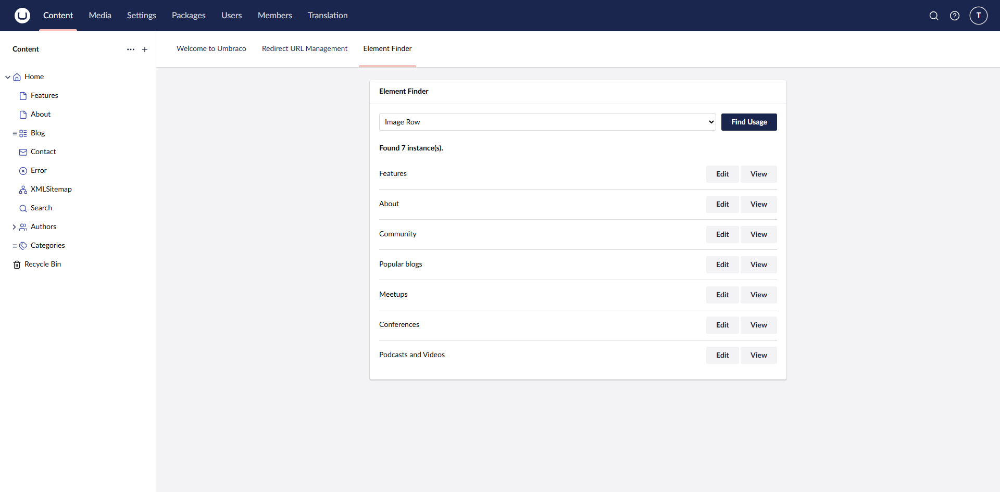
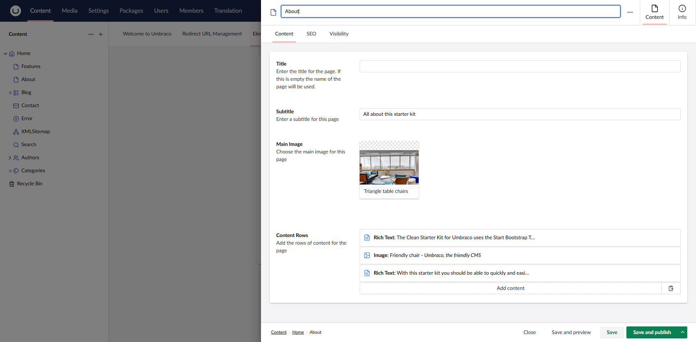

# Element Finder

**Element Finder** is an Umbraco package that adds a dashboard to the CMS, allowing users to search for elements or blocks being used within the CMS.

No configuration is required for the package. Once installed, log into the CMS and use the Element Finder dashboard in the Content section, or open a Document Type in Settings and select the Usage tab.

The package also allows you to quickly view and edit the content of the pages.

## Requirements

Umbraco 17.0+

## Installation

### Visual Studio

Simply search for the `Pixelbuilders.Umbraco.ElementFinder` NuGet package and add it to your project.

### CLI

`dotnet add package Pixelbuilders.Umbraco.ElementFinder`

## What It Scans

Element Finder scans content nodes for:

- Direct usage of a selected Document Type.
- Block editor JSON containing matching element type keys in `contentData` or `settingsData`.
- Document Types or Element Types that use the selected type through composition.

## Backoffice Views

- The Content section dashboard lets editors pick a Document Type or Element Type and search for usage across the site.
- The Settings workspace Usage tab appears when editing a Document Type and shows where that type is used.

## Known Limitations

- Usage checks currently scan content in batches and inspect JSON property values in-process, so very large content trees may take longer to search.
- The scanner is focused on content and block editor data. It does not currently report usage from templates, code, dictionary items, media, member data, or custom storage.
- Invalid or unsupported JSON property values are skipped.
- Results depend on published URL resolution, so unpublished or unusual routing scenarios may affect the displayed URL.

## Development Notes

The package is a Razor Class Library and serves its backoffice assets through RCL static web assets. The client app lives in `src/Pixelbuilders.Umbraco.ElementFinder/Client`.

Normal package builds run `npm ci` and `npm run build` for the client. To skip the client build when assets are already up to date, pass:

`/p:SkipElementFinderClientBuild=true`
