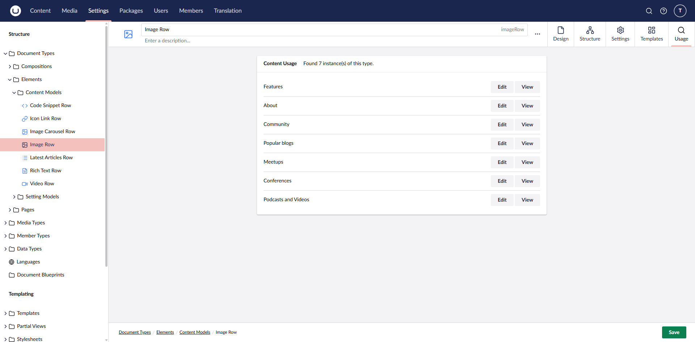

# Element Finder

**Element Finder** is an Umbraco package that helps editors find where document types, element types, and blocks are used within the CMS.

No configuration is required for the package. Once installed, log into the CMS and use the Element Finder dashboard in the Content section, or open a Document Type in Settings and select the Usage tab.

[](https://raw.githubusercontent.com/pixelbuilders/PixelBuilders.Umbraco.ElementFinder/refs/heads/main/images/image-1.png)

[](https://raw.githubusercontent.com/pixelbuilders/PixelBuilders.Umbraco.ElementFinder/refs/heads/main/images/image-3.png)

The package also allows editors to quickly view and edit the matching content items.

[](https://raw.githubusercontent.com/pixelbuilders/PixelBuilders.Umbraco.ElementFinder/refs/heads/main/images/image-2.png)

## Requirements

Element Finder supports Umbraco 13 and 17 through different package versions.

## Package Version Guide

Install the package version that matches your Umbraco major version:

| Umbraco version | Element Finder package version |
| --- | --- |
| Umbraco 17 | `17.0.0` |
| Umbraco 13 | `1.0.1` |

## Installation

### Visual Studio

1. Open `Manage NuGet Packages` for your Umbraco project.
2. Search for `Pixelbuilders.Umbraco.ElementFinder`.
3. Install the package version that matches your Umbraco version.

### CLI

For Umbraco 17:

```bash
dotnet add package Pixelbuilders.Umbraco.ElementFinder --version 17.0.0
```

For Umbraco 13:

```bash
dotnet add package Pixelbuilders.Umbraco.ElementFinder --version 1.0.1
```

## What It Scans

Element Finder scans content nodes for:

- Direct usage of a selected Document Type.
- Block editor JSON containing matching element type keys in `contentData` or `settingsData`.
- Document Types or Element Types that use the selected type through composition.

## Backoffice Views

- The Content section dashboard lets editors pick a Document Type or Element Type and search for usage across the site.
- The Settings workspace Usage tab appears when editing a Document Type and shows where that type is used.

## Known Limitations

- Usage checks currently scan content in batches and inspect JSON property values in-process, so very large content trees may take longer to search.
- The scanner is focused on content and block editor data. It does not currently report usage from templates, code, dictionary items, media, member data, or custom storage.
- Invalid or unsupported JSON property values are skipped.
- Results depend on published URL resolution, so unpublished or unusual routing scenarios may affect the displayed URL.

## Development Notes

The package is a Razor Class Library and serves its backoffice assets through RCL static web assets. The client app lives in `src/Pixelbuilders.Umbraco.ElementFinder/Client`.

If you are building the package from source, use the Node version that matches the target Umbraco major version:

- Umbraco 17 package line: `^18.18.0 || ^20.9.0 || >=22.10.0`

Normal package builds run `npm ci` and `npm run build` for the client.
